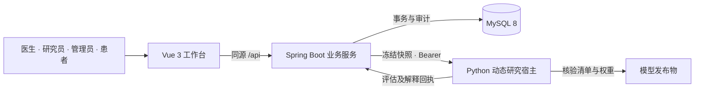

# AD-CausalRisk

[](https://github.com/yanxiao07/AD-CausalRisk/actions/workflows/backend-build.yml)
[](https://github.com/yanxiao07/AD-CausalRisk/actions/workflows/frontend-build.yml)
[](https://github.com/yanxiao07/AD-CausalRisk/actions/workflows/python-base.yml)
[](https://github.com/yanxiao07/AD-CausalRisk/actions/workflows/python-research-primitives.yml)

AD-CausalRisk 是面向阿尔茨海默病研究的协作平台。它把受试者建档、访视录入、资料质控、研究模型评估、医生复核和患者随访接在同一个工作流中。四角色软件流程已用人工档案完成端到端验证。预测和解释用于研究验证，真实病例准入与临床有效性另有独立要求。

[快速开始](#快速开始) · [角色流程](#角色流程) · [系统架构](#系统架构) · [验证与升级](#验证与升级) · [文档与贡献](#文档与贡献)

## 角色流程

| 角色 | 工作台操作 |
| --- | --- |
| 医生 | 建档、保存并回看访视、发起当前版本质控、申请患者账号、提交评估申请、处理补件、复核报告和安排复诊。医生可以独立发布或撤回患者可见说明。 |
| 研究员 | 预检并导入测试资料、做质控、登记七变量测试快照、处理获授权的研究申请与补件、跟踪评估和查看报告。 |
| 管理员 | 核对患者身份后发放账号，办理责任医生交接，管理档案权限和审计，核对模型仓库与宿主实际加载的发布物。 |
| 患者 | 查看本人评估进度、医生已发布的说明、责任医生及联系渠道、下次和其他复诊。可以确认、申请改期并查看回执。 |

医生保存访视并对当前资料质控后，可独立发起患者账号申请和研究评估申请。管理员发放患者账号时，再次核对质控、档案和责任医生。研究员核验证据，合格的冻结快照才交给模型。模型结果回到医生复核队列。患者收到经医生单独发布的说明。等待改期期间原复诊继续有效，医院处理后患者可查看回执。

**研究员 CSV 怎么用？** 档案、访视、特征模板服务于 `DEMO-` 档案入库与质控。七变量模型模板把同一次已质控访视的 MMSE、CDR-SB 与其余五项输入绑定，生成测试快照。提交模型评估是单独操作。独立队列验证和重新拟合在科研流程中办理。

## 系统架构



Java 负责会话、对象授权、档案版本、任务与结果持久化。Python 负责核对输入和计算，执行状态以 Java 保存的实际回执为准。患者接口以白名单返回进度、医生说明和复诊安排。后台可按清单及权重摘要核对 Java 仓库和 Python 宿主，模型加载由宿主配置管理。

## 快速开始

需要 JDK 21、Node.js 22.12+、Python 3.11/3.12 和 Git。目标数据库为 MySQL 8。只体验界面和工作流，可先用本机 H2。以下命令以 Windows PowerShell 7 为例。

```powershell
git clone https://github.com/yanxiao07/AD-CausalRisk.git
Set-Location AD-CausalRisk
```

### 启动 Java 与 Vue

在终端一从仓库根目录启动 Java。以下使用专用演练文件库，Flyway 初始化 V1–V29。

```powershell
Set-Location backend
.\mvnw.cmd -B -ntp -DskipTests package
New-Item -ItemType Directory -Force runtime | Out-Null
$env:SPRING_DATASOURCE_URL = 'jdbc:h2:file:./runtime/adcr-demo;MODE=MySQL;DATABASE_TO_LOWER=TRUE;CASE_INSENSITIVE_IDENTIFIERS=TRUE'
$env:SPRING_DATASOURCE_USERNAME = 'sa'
$env:SPRING_DATASOURCE_PASSWORD = ''
$env:SPRING_DATASOURCE_DRIVER_CLASS_NAME = 'org.h2.Driver'
java -jar target/backend-0.1.0-SNAPSHOT.jar --server.address=127.0.0.1
```

在终端二从仓库根目录启动 Vue，访问 [本机登录页](http://127.0.0.1:5173/login)。默认 Vue、Java 和研究宿主端口分别为 `5173`、`8080`、`16301`。

```powershell
Set-Location frontend
npm.cmd ci
npm.cmd run dev -- --host 127.0.0.1 --port 5173 --strictPort
```

本机演练账号为 `doctor`、`researcher`、`admin` 和 `patient`，初始演练口令为 `DemoPass!2026`。医生可先建 `DEMO-` 档案并保存访视。初始患者账号可能尚未绑定档案，可通过患者账号申请发放并登录新账号。演练账号仅用于回环环境。

MySQL 部署使用专用 schema 和数据库账号，配置方式见 [Java 后端](backend/README.md) 与 [MySQL 8 验收及恢复](docs/MySQL8_Acceptance.md)。

### 接入已训练模型

模型保管方提供原始清单、同目录权重和可信 SHA-256。在终端三从仓库根目录启动动态研究宿主。初次配置 Java 时按 [后端模型身份配置](backend/README.md#本地研究任务联调) 核对 Java 使用的清单和摘要。

```powershell
python -m venv .venv
.\.venv\Scripts\python.exe -m pip install -r research_runtime/requirements.lock
$env:RESEARCH_TABLE_TEST_TOKEN = Read-Host '研究宿主访问令牌' -MaskInput
.\.venv\Scripts\python.exe -B -m research_runtime.dynamic_host `
  --port 16301 `
  --manifest 'C:/controlled-model/Model_Manifest.json' `
  --trusted-manifest-sha256 '<模型保管方提供的 SHA-256>' `
  --snapshot-dir runtime/demo-snapshots
```

在管理员的「系统设置 → 评估服务配置」填写 `http://127.0.0.1:16301` 和同一令牌。打开「模型版本库」核对宿主的模型清单。研究员可从「导入测试资料」生成已质控的七变量测试快照，再到「研究证据」选择快照并提交预测。若暂时没有模型文件，可运行下节的合成 HTTP 验证。

## 验证与升级

从仓库根目录运行以下命令。`verify` 使用独立 H2 测试库。Python HTTP 验证使用公开构造参数、独立测试库和环回端口，输出目录应为新目录。

```powershell
Push-Location backend
.\mvnw.cmd -B -ntp verify
Pop-Location

Push-Location frontend
npm.cmd ci
npm.cmd run build
Pop-Location

python -m venv .venv
.\.venv\Scripts\python.exe -m pip install -r requirements-dev.lock
.\.venv\Scripts\python.exe -B -m unittest discover -s tests -v
.\.venv\Scripts\python.exe -B -m research_runtime.examples.run_research_table_integration runtime/contract-demo --contract-test
```

| 范围 | 交付状态 |
| --- | --- |
| Java / Vue / Python | 115 个 Java API 操作。Java 全量回归、Vue 构建、Python 契约和动态宿主验证均已运行。远端 CI 结果见仓库 Actions。 |
| 数据库与角色联调 | H2 和隔离 MySQL 8.0.46 验证过升级、查询和持久化。Edge 用人工档案走过账号交接、CSV、实际 Python 推理、报告、发布、撤回及复诊。 |
| 科研 | 已有七变量和十变量表格基线。当前解释展示同一次预测的输入贡献及局限。个人因果识别、图引导的预测增益和独立队列有效性仍需科研证据。 |
| 医院与患者应用 | 真实回顾性病例需取得同次访视的原始来源、量表完成、独立质控及使用和执行许可。老年用户真机试用、医院号源、HIS、消息通知和正式部署仍待对应验收。 |

已有数据库升级前应备份业务库、宿主快照目录及发布物配置。Flyway 只向前迁移。回退应用时应恢复与旧版本配套的备份副本。详细步骤见 [MySQL 8 验收](docs/MySQL8_Acceptance.md) 与 [备份恢复演练](docs/MySQL_Backup_Restore_Drill.md)。

## 文档与贡献

| 入口 | 内容 |
| --- | --- |
| [业务状态](docs/Business_Feature_Status.md) · [设计指南](docs/Design_Guide.md) | 角色、工作流、权限和兼容说明 |
| [Java 后端](backend/README.md) · [Vue 前端](frontend/README.md) · [研究运行时](research_runtime/README.md) | 各模块的启动、配置、构建和调试 |
| [Java OpenAPI](contracts/java-business.target.openapi.json) · [研究宿主 OpenAPI](docs/contracts/research-table-agent.draft.openapi.json) · [集成契约](docs/Integration_Contract.md) | 接口、认证、数据范围和失败回执 |
| [研究主线](docs/Research_Core_Principles.md) · [研究进展](docs/Research_Progress_and_Integration.md) · [受控资料准入](docs/Research_Host_Evidence_Admission.md) | 模型证据、适用边界和真实来源要求 |
| [发布说明](docs/Release_Notes_v1.0.md) · [贡献指南](CONTRIBUTING.md) | 变更历史、分支和评审流程 |

```text
backend/          Spring Boot、Flyway、授权、任务和审计
frontend/         Vue 四角色工作台
research_runtime/ 动态研究宿主、模型校验和预测解释
python_service/   历史 Agent 合成契约与兼容回归
contracts/        业务及历史 Agent OpenAPI
fixtures/         可公开的合成档案与 CSV
docs/             设计、研究证据、验收及运维说明
```

报告故障时可附版本、角色、预期操作和脱敏后的 `traceId`。病例、快照、权重和令牌通过各自受控渠道传递。仓库包含第三方依赖及字体，各自许可见对应文件。研究数据和权重依照原始授权使用。
