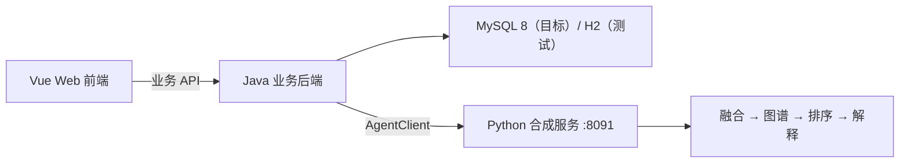

# AD-CausalRisk

面向阿尔茨海默病风险研究的多源数据、条件图谱和可解释排序系统。

[](https://github.com/yanxiao07/AD-CausalRisk/actions/workflows/python-base.yml?query=branch%3Amain)
[](https://github.com/yanxiao07/AD-CausalRisk/actions/workflows/backend-build.yml?query=branch%3Amain)

[快速开始](#快速开始) · [项目状态](#项目状态) · [文档导航](#文档导航) · [参与贡献](#参与贡献) · [路线图](#路线图)

AD-CausalRisk 将资料整理、质量检查、图谱、排序和解释组织为可追溯的工作流。Python 提供可独立运行的合成数据服务；Java 承担业务 API、权限与持久化；前端面向研究人员、医生和患者提供相应视图。

[独立表格研究通道](docs/Research_Table_Agent_Contract.md)已用人工快照接通 Java 和独立 Python HTTP 宿主。当前只接受构造样例，真实数据预测尚未接入；现有课程服务保持原接口。

研究主线固定为**多源数据融合 → 个体化因果图谱构建 → 因果引导的预警模型建立 → 个体化可解释性分析**。后续任务按[四环节研究与推进规范](docs/Research_Core_Principles.md)对应缺口、复用已有成果并设置验收终点；该目标不表示个体因果结构、图增益或临床用途已经成立。

第2→3环节[固定三臂图预测研究](docs/Graph_Research_Execution.md)已完成54真实训练/模型交付，未确立固定先验增益；第4环节[图解释诊断](docs/Graph_Explanation_Results.md)已复用45外折模型完成数值重构/实际路径与敏感性验收。贡献顺序敏感，未建立严格个人因果或稳定/临床解释。

**项目正在开发中。** 当前课程服务使用明确标记的合成数据与固定加性规则，输出用于教学和工程联调。排序分数不是经临床验证的个体患病概率，图谱箭头不代表已识别的因果或治疗效应。

七变量三算法及固定遗传/横断MRI的离线训练与对照已有阶段交付；新模型尚未替换当前业务服务。研究完成范围、Git交付内容及Java如何取数调用Python，见[研究交付与接入说明](docs/Research_Progress_and_Integration.md)。

可移植估计器、人月/CIF、已保存模型的离线合成验收，以及固定五外折/三内折训练与嵌套校准，见[研究模型 Python 接入准备](docs/Research_Model_Portability.md)与[运行说明](research_runtime/README.md)。该可选模块使用独立依赖。合成 HTTP 联调已通过；真实研究宿主和业务接入单独验收。

研究运行时已包含[分组Shapley/LIME及表格编排](docs/Table_Grouped_Study_Execution.md)、[输入声明一致性校验](docs/Real_Input_Admission.md)与[单次内存CIF调用](docs/InMemory_Research_Inference.md)。方法、构造验收和真实研究结论分别报告；不加入受控数据/权重，不改变共享HTTP或默认模型。

七/十变量的[Python接入候选](docs/Research_Model_Integration_Candidate.md)补充六个表格组合、[模型身份到宿主上下文的映射](docs/Research_Model_Identity_Map.md)和[人工预测/解释绑定示例](docs/Prediction_Explanation_Binding_Candidate.md)。[宿主证据核对](docs/Research_Host_Evidence_Admission.md)保留已定位材料与剩余资格缺口，完整准入仍为NO_GO；人工示例通过不表示真实模型已接入业务。

## Java 适配入口

现有演示调用继续使用 `deepagent-v1`。七/十变量研究评估提供 Python 内存入口、结果校验和独立合成 HTTP 宿主。Java 已实现冻结快照提交、任务和结果持久化、幂等及超时处理。[后端接口与配置](backend/README.md#表格研究评估适配)

| Java 适配项 | 实现要求 |
| --- | --- |
| 冻结取数 | 按对象授权冻结档案、数据版本、索引日和时间策略，记录原值、单位、测量/可用日期、来源、独立 QC、完成状态和缺失原因。复用现有 MMSE/CDR-SB 原值的来源链，补齐年龄、教育年限、CDR-global、ADAS13 和 FAQ。十变量还需整数 APOE4 计数与同一扫描的双侧海马体积 `mm3`。 |
| 请求与信任 | 独立研究 DTO 携带固定 24 个月窗口、模型别名和冻结快照。由宿主独立绑定模型、来源和授权。旧演示 DTO、`normalized` MRI 和 JSON 自供的可信上下文不具备这一资格。 |
| 结果与权限 | 校验原请求、模型和快照身份，再保存双原因 CIF 及绑定同一次评估的解释。阻断结果保留显式 null。采用独立结果版本和权限，患者摘要使用 Java 白名单。 |
| 幂等与超时 | Java 持久化任务、请求快照、幂等键、结果和审计。研究 `runId` 仅用于关联。超时记录结局未知，保留原任务供核对，避免自动重发 POST。 |

独立合成联调通过真实 Java 登录会话覆盖两规格完成、QC 阻断、越权、身份错绑、幂等与历史回读。前端可按[本地研究任务联调](backend/README.md#本地研究任务联调)启动两端并取得三个人工快照 ID。超时路径由 Java 环回故障用例覆盖。字段、单位、授权和存储见[研究契约与 Java 责任](docs/Research_Table_Agent_Contract.md)，Python 线协议见 [OpenAPI 草案](docs/contracts/research-table-agent.draft.openapi.json)。

[Deep Agents 证据核对](examples/research_evidence/README.md)是独立 Python 研究示例。它通过只读工具检查人工评估的来源、同次结果绑定和适用范围，核验失败时保留确定性报告。Java 适配范围以研究评估契约为准。

## 核心能力

新增离线评价与监测见[研究运行说明](research_runtime/README.md)：自然模态分层、固定结构选择稳定性、未知结局分类/DCA补全界限及同一快照的漂移/性能联合报告。它们复用调用方内存，不改变当前合成业务服务或默认模型。固定图增益阴性、结构四折不可估和真实阈值报告整表抑制均保留；真实监控与临床用途未完成。

- **资料与质量**：三表 CSV 预检、档案关联、日期与单位检查、缺失/重复/冲突定位，以及严重问题阻断。
- **四阶段工作流**：`DATA_FUSION → CAUSAL_GRAPH → WARNING_MODEL → EXPLANATION`，保留原值、来源时间、版本、实际阶段与耗时。
- **可追溯解释**：原图模板、图到评分输入的门控、逐项贡献与截断/舍入重构，以及说明文字的语义校验。
- **联调与故障处理**：版本化 HTTP 契约、标准库客户端、易失缓存重放、故障案例、只读恢复和合成批处理。
- **研究工程工具**：纵向特征矩阵、缺失输入敏感性、合成解释一致性和构造概率评估；各工具的适用范围见对应文档。

## 项目状态

验收以[课程需求基线](docs/Course_SRS_V3_2.md)为准，逐项状态见[后端验收](docs/Backend_Requirements_Acceptance.md)和[业务状态](docs/Business_Feature_Status.md)。

| 模块 | 已有实现 | 后续工作 |
| --- | --- | --- |
| Python | 合成四阶段服务、契约/身份校验、客户端；可选离线训练、解释、评价与联合监测计算 | 当前业务仍使用合成规则；研究模型服务、真实监控输入及临床验证单独验收 |
| Java 后端 | 61 个业务操作，包含表格研究任务；Flyway 迁移至 V13 | [MySQL 8 迁移、备份恢复和重启回读](docs/MySQL8_Acceptance.md)待目标库验收 |
| Web 前端 | Vue 3、真实会话和四角色业务页面 | [异步评估、报告下载和表格研究任务](frontend/README.md#待接入接口)仍待页面接入 |
| 全链路 | 浏览器→Java→Python合成调用链已有实现；Java负责业务保存与权限 | MySQL、全场景故障/重启和浏览器端到端验收单独完成；离线研究模块不自动接入业务 |

接口目标、数据库表或页面片段的存在不表示对应业务已完成。Python 工程测试也不替代 Java、MySQL 或浏览器端到端验收。

## 快速开始

先运行 Python 合成服务，完成一次请求与查询。该流程不需要 Java、数据库或研究数据。文档与运行源码应来自同一分支。

### 环境要求

| 模块 | 环境 |
| --- | --- |
| Python 服务 | Python 3.11 或 3.12；运行时仅使用标准库 |
| Python 测试 | 同一解释器安装 `requirements-dev.lock` |
| 可选离线研究模块 | 独立环境安装`research_runtime/requirements.lock`；原生图模块使用`requirements.graph.lock`，不与课程环境混装 |
| Java 后端 | JDK 21、Maven Wrapper；目标数据库 MySQL 8，自动测试使用 H2 |
| Web 前端 | Node.js 22.12 或更新的 22.x，使用 `npm ci` 安装锁定依赖；见[前端说明](frontend/README.md) |

```bash
git clone https://github.com/yanxiao07/AD-CausalRisk.git
cd AD-CausalRisk
```

完整系统另需按[后端说明](backend/README.md)显式配置数据库/profile并启动Java，再在`frontend/`运行`npm ci`与`npm run dev`。默认前端5173将`/api`代理到Java8080，Java再调用Python8091；缺少数据库配置不会自动回退为已接通环境。

### 启动 Python 服务

Windows PowerShell：

```powershell
py -3.11 -m venv .venv
.venv/Scripts/python.exe -m pip install -r requirements.txt
.venv/Scripts/python.exe -m python_service.server --port 8091
```

如果安装的是 Python 3.12，将第一行的 `-3.11` 改为 `-3.12`。可用 `py --list` 查看本机版本。

Linux / macOS（先确认 `python3 --version` 为 3.11 或 3.12）：

```bash
python3 -m venv .venv
.venv/bin/python -m pip install -r requirements.txt
.venv/bin/python -m python_service.server --port 8091
```

服务监听 `http://127.0.0.1:8091`。保持终端运行，另开终端执行下面的请求。

### 提交并查询一个合成案例

Windows PowerShell：

```powershell
Invoke-RestMethod http://127.0.0.1:8091/api/health

$request = Get-Content contracts/examples/deepagent-v1.request.example.json -Raw -Encoding UTF8
$body = [Text.Encoding]::UTF8.GetBytes($request)
Invoke-RestMethod http://127.0.0.1:8091/api/agent/v1/runs -Method Post -ContentType application/json -Body $body

Invoke-RestMethod http://127.0.0.1:8091/api/agent/v1/runs/run-demo-001
```

Linux / macOS：

```bash
curl --fail http://127.0.0.1:8091/api/health
curl --fail -H 'Content-Type: application/json' --data-binary @contracts/examples/deepagent-v1.request.example.json http://127.0.0.1:8091/api/agent/v1/runs
curl --fail http://127.0.0.1:8091/api/agent/v1/runs/run-demo-001
```

示例响应的关键字段如下；完整结果还包含图、解释、版本、限制和四阶段轨迹。`durationMs` 随实际执行变化。

```json
{
  "status": "COMPLETED",
  "qualityStatus": "PASS",
  "riskScore": 0.8304,
  "riskLevel": "HIGH",
  "dataSource": "SYNTHETIC_DEMO",
  "reviewRequired": true
}
```

### 使用演示数据

| 文件 | 内容 |
| --- | --- |
| [`fixtures/synthetic_subjects_100.json`](fixtures/synthetic_subjects_100.json) | 100 个单档案请求；每次提交一个 `subjects` 元素 |
| [`fixtures/subjects.synthetic.csv`](fixtures/subjects.synthetic.csv) | 100 个合成档案 |
| [`fixtures/visits.synthetic.csv`](fixtures/visits.synthetic.csv) | 200 条访视 |
| [`fixtures/features.synthetic.csv`](fixtures/features.synthetic.csv) | 300 条特征观测 |
| [`contracts/examples/`](contracts/examples/) | 请求、响应与跨语言字段示例 |

档案使用 `DEMO-*` 编号，数据版本使用 `demo-*`。不要把整个 100 档案 JSON 直接提交给单档案接口。三表预检和批量调用见[CSV 预检](docs/Python_Csv_Preflight.md)与[合成批处理](docs/Python_Synthetic_Batches.md)。

## 架构与契约

当前合成业务调用关系如下；可选离线研究计算不在这条HTTP链路内：



| 接口 | 用途 | 契约 |
| --- | --- | --- |
| `GET /api/health` | 服务模式与版本 | [Python OpenAPI](contracts/python-agent.openapi.json) |
| `POST /api/agent/v1/runs` | 同步执行一个合成请求 | 同上 |
| `GET /api/agent/v1/runs/{runId}` | 查询进程内已有结果 | 同上 |
| Java 业务 API | 会话、档案、任务、结果与业务管理 | [目标 OpenAPI](contracts/java-business.target.openapi.json)；逐项实现状态见后端说明 |

接入时须保留以下语义：

- 浏览器调用 Java，Java 调用 Python；用户权限、对象范围、业务任务和历史结果由 Java 管理。
- Python 同步返回实际阶段与耗时，运行中不提供实时阶段推送。缓存仅存在于进程内，重启后清空。
- 请求层接受 6–60 个月整数，当前规则只支持 24 个月。其他有效窗口或严重质量问题返回 `BLOCKED`，其分数必须为 `null`、等级为 `UNAVAILABLE`。
- Java 的业务 `Idempotency-Key` 与 Python 的 `runId` 分别管理。同一 `runId`、同一请求重放返回原结果；同 ID 不同请求返回冲突。超时后先按原 ID 查询和核对，不自动换 ID 重发。
- 模型、数据、工作流版本及日期、单位、缺失必须保留。患者摘要由 Java 过滤原始排序数值、图权重与内部轨迹。
- 原生解释和图说明须符合固定规则；未知阶段 `summary` 字段、附加 `limitations` 及不符合原规则的说明会被语义校验拒绝，见[输出审查](docs/Python_Output_Review.md)。

详细状态、错误映射及图到评分的关系见[联调约定](docs/Integration_Contract.md)。`python-demo-logistic-v1` 是保留的接口标识，实际课程计算为固定加性规则，不应据名称推断已训练逻辑回归。

## 开发与测试

### Python

在仓库根目录安装测试依赖并运行：

```powershell
# Windows PowerShell
.venv/Scripts/python.exe -m pip install -r requirements-dev.lock
.venv/Scripts/python.exe -m unittest discover -s tests -v
```

```bash
# Linux / macOS
.venv/bin/python -m pip install -r requirements-dev.lock
.venv/bin/python -m unittest discover -s tests -v
```

测试覆盖契约与 HTTP、阻断、版本、并发重放、缓存、融合来源、贡献重构、输出审查，以及合成研究工程工具的计算边界。测试不需要真实临床数据。

### 可选离线研究模块

课程测试和可选研究测试使用不同环境。表格与图模块分别使用独立依赖，不能在仅安装表格依赖的环境中发现整个研究测试目录。按专题选择：

```powershell
# 表格估计器、固定训练与嵌套校准
py -3.11 -m venv .venv-research
.venv-research/Scripts/python.exe -m pip install -r research_runtime/requirements.lock
.venv-research/Scripts/python.exe -m unittest research_runtime.tests.test_runtime research_runtime.tests.test_training -v

# 图模块另用独立CPU环境，保持原课程与表格环境
py -3.11 -m venv .venv-research-graph
.venv-research-graph/Scripts/python.exe -m pip install -r research_runtime/requirements.graph.lock
.venv-research-graph/Scripts/python.exe -m unittest research_runtime.tests.test_graph research_runtime.tests.test_graph_native research_runtime.tests.test_graph_training research_runtime.tests.test_graph_explanation -v
```

上述研究测试包含人工数据构造拟合，不读取真实队列或权重。已有固定真实研究不因源码发布重训。课程Python CI只发现`tests/`；独立的研究原语CI显式选择69项标准库和139项NumPy人工检查，不发现整个研究测试目录，不执行预测拟合、模型加载或真实研究。最小依赖与对应命令见[研究运行说明](research_runtime/README.md#研究原语分层ci)。协议机器文件保留原始字节，阶段文档以交付状态说明区分历史与当前，最新完成项及唯一下一任务以[Python需求状态](docs/Python_Requirement_Status.md)为准。

### Java

在 `backend/` 执行 `.\mvnw.cmd -B -ntp verify`（Windows PowerShell）或 `./mvnw -B -ntp verify`（Linux / macOS）。启动配置和真实 HTTP 联调命令见[后端说明](backend/README.md)。H2 测试不覆盖 MySQL 8 部署验收。

### 持续集成

| 工作流 | 当前配置 |
| --- | --- |
| [Python service and contract checks](.github/workflows/python-base.yml) | Python 3.11 / 3.12，固定测试依赖，`unittest` |
| [Python research primitive checks](.github/workflows/python-research-primitives.yml) | Windows / Ubuntu × Python 3.11 / 3.12，标准库69项与仅NumPy139项分别运行 |
| [Java backend build and tests](.github/workflows/backend-build.yml) | JDK 21，Maven `verify`，H2 测试及独立 Python 宿主的真实 Java HTTP 验收 |

推送和 PR 会触发上述工作流，结果见 [GitHub Actions](https://github.com/yanxiao07/AD-CausalRisk/actions)。前端构建和浏览器测试命令见[前端说明](frontend/README.md)。

既有因果识别论证的[标准库精确示例](docs/Causal_Identification_Results.md)现随源码交付，运行 `python -I -S -B examples/causal_identification_audit.py` 可核对9项精确检查。该示例在研究CI标准库矩阵中单独运行；数学反例不构成本研究的因果效应或临床证据。

FR-22的[实验配置限定导出](docs/Research_Experiment_Config.md)提供标准库内存API和人工示例，覆盖六表格组合及固定三臂/三种子的单图模型、三种子CIF均值配置；仅导出选择、策略及发布级摘要，表格v1字节兼容，不授予执行或临床权限。[6模型组件与人工数值绑定](docs/Model_Artifact_Admission.md)续轮已通过：6份参数各加载一次，9个人工案例69次CIF的预测/解释一致性通过；首轮停止记录保留，真实宿主独立资格仍NO_GO。

[运行源码/锁一致性范围](docs/Research_Runtime_Binding.md)记录8源码、12依赖及安装RECORD核对；锁LF/CRLF字节对象、无哈希成员及发行/执行资格限制分列，不作为真实业务准入许可。

## 文档导航

| 主题 | 文档 |
| --- | --- |
| 需求与责任 | [课程 SRS](docs/Course_SRS_V3_2.md) · [业务设计](docs/Design_Guide.md) · [Python覆盖与缺口](docs/Python_Requirement_Status.md) |
| 联调与故障 | [联调约定](docs/Integration_Contract.md) · [接口阶段验收](docs/Python_Interface_Acceptance.md) · [并发与失败处理](docs/Python_Concurrent_Execution.md) · [故障与只读恢复](docs/Python_Interop_Recovery.md) |
| 数据与质量 | [CSV 预检](docs/Python_Csv_Preflight.md) · [质量报告](docs/Python_Quality_Review.md) · [特征融合](docs/Python_Feature_Fusion.md) |
| 图与解释 | [核心结果校验](docs/Python_Core_Validation.md) · [图谱证据](docs/Python_Graph_Evidence.md) · [解释一致性](docs/Python_Explanation_Consistency.md) · [输出审查](docs/Python_Output_Review.md) |
| 评估与缺失 | [构造预测评估](docs/Python_Prediction_Evaluation.md) · [缺失输入敏感性](docs/Python_Missingness_Sensitivity.md) |
| 合成报告与批处理 | [HTML/JSON/CSV报告](docs/Python_Course_Reports.md) · [合成批处理](docs/Python_Synthetic_Batches.md) · [报告适配](docs/Synthetic_Reports.md) |
| 可选受控研究接入 | [运行时集成](docs/Research_Runtime_Integration.md) · [受控客户端](docs/Controlled_Research_Client.md) · [研究基底与验收](docs/Research_Backend_Acceptance.md) · [模型与任务反馈](docs/Model_And_Task_Feedback.md) |
| 团队开发 | [贡献指南](CONTRIBUTING.md) · [AI 协作指南](docs/AI_Collaboration.md) · [助手规则](AGENTS.md) |

可选研究接入依赖独立授权环境，普通克隆不会获得受限数据或研究模型；不影响上面的课程合成服务快速开始。

## 仓库结构

```text
.
├── python_service/       # 四阶段服务、客户端与工程工具
├── backend/              # Java 业务后端与数据库迁移
├── frontend/             # Vue业务前端、角色页面与测试脚本
├── contracts/            # 冻结契约与请求/响应示例
├── fixtures/             # 合成档案、访视和特征
├── tests/                # Python 与契约测试
├── docs/                 # 需求、设计、联调和专题说明
├── research_gateway/     # 可选研究接入适配
├── research_runtime/     # 可选离线估计器、固定训练/校准与图计算源码；独立依赖
├── .github/              # CI 工作流与 PR 模板
├── CONTRIBUTING.md       # 协作流程
└── AGENTS.md             # 编码助手约束
```

## 参与贡献

欢迎通过 [Issues](https://github.com/yanxiao07/AD-CausalRisk/issues) 报告问题或讨论需求，通过 [Pull requests](https://github.com/yanxiao07/AD-CausalRisk/pulls) 提交实现。开始前阅读[贡献指南](CONTRIBUTING.md)和对应模块说明，确认需求编号、文件范围与验收条件。

1. 从最新 `main` 创建功能分支；无仓库写权限时使用 Fork。
2. 按模块完成一个可测试的变更，运行本模块及受影响的共同检查。
3. 提交 PR，说明行为变化、对应需求、实际测试、兼容影响及未完成项，参照[PR 模板](.github/pull_request_template.md)。
4. 经 CI 和评审后合并。共同契约变更先明确字段、版本和调用方影响，不用 Mock 或改写评分规则掩盖集成失败。

分工保持清晰：Python 维护工作流与算法契约；Java 负责权限、持久化和业务 API；前端负责会话、页面与交互。AI 辅助开发同样需要人工核对差异与测试，工作规则见 [AGENTS.md](AGENTS.md)。

## 路线图

- [x] Python 合成四阶段服务、固定契约与请求/结果校验。
- [x] CSV 预检、质量报告、原规则来源追溯及合成工程工具。
- [x] Java 工程、迁移、认证、档案与访视基础接口；CSV 预览、确认入库和导入幂等。
- [x] Java质控（QC）模块：审核队列、审核决策与状态统计。
- [x] Java特征读取、持久化任务与实际AgentClient；保留BLOCKED/null及失败原因。
- [x] Web工程、业务页面、四角色视图及测试脚本；移动端与全部交互场景另验收。
- [x] 业务复核、随访、授权报告资源及内部评估的患者访问限制。
- [x] 业务审计、患者白名单摘要、账号与授权管理；契约与验证边界见[后端验收](docs/Backend_Requirements_Acceptance.md)。
- [x] 表格研究人工快照、Java 登录会话和独立 Python 宿主联调。
- [ ] 前端接入新接口，完成浏览器验收。
- [ ] MySQL、浏览器及跨服务故障/重启历史的端到端验收。

研究算法与科学验收单独跟踪：固定训练扰动、分组归因及自然模态分层已有阶段交付，真实累计673基础/36校准；[当前需求状态](docs/Python_Requirement_Status.md)保留图增益阴性、结构四折不可估、CSF NO_GO和真实阈值整表抑制。维护主机研究页面不包含在本仓库。研究依赖与课程环境分开，图专题使用图锁环境。严格个人因果、独立/as-of/QC、研究模型业务接入和临床验证仍未完成。

## 使用范围与许可

仓库中的 `DEMO-*` 与 `SYNTHETIC_DEMO` 资料用于系统联调与功能验证。真实来源数据、个人身份信息、凭据、模型授权材料及运行缓存不得随代码提交。合成报告和自动校验不代替医生人工复核、对象授权或临床验证。

当前仓库尚未提供 `LICENSE` 文件，许可证方案待维护者确定。
